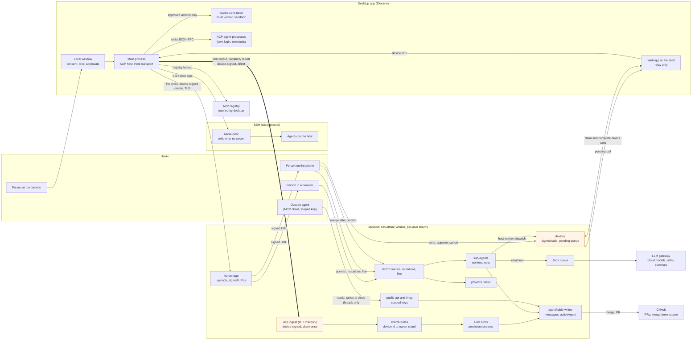

# Agent host architecture: how the parts connect

Status: diagram, 2026-10-26. Derived from the plans in this folder; it adds no
decisions. Index: [agent-host-roadmap.md](agent-host-roadmap.md).

## 1. Diagram

Orange nodes are the trust boundary: device-signed traffic from the desktop, and
the pending-call queue that the page relays.

## 2. What each connection carries

| From | To | Carries | Plan |
| --- | --- | --- | --- |
| Local window | Main process | consent, local permission answers | [acp-agent-host.md](acp-agent-host.md) §3 |
| Web page (shell) | Backend | pending device calls claimed, results completed | [acp-agent-host.md](acp-agent-host.md) §4 |
| Main process | ACP agent | JSON-RPC over stdio; the agent runs its own tools | [acp-agent-host.md](acp-agent-host.md) §3 |
| Main process | Backend ingest | turn chunks, turn end, capability report; device-signed | [acp-agent-host.md](acp-agent-host.md) §4 |
| Ingest | Thread owner's shard | routed by the `device:<id>` row in `shardRoutes` | [acp-agent-host.md](acp-agent-host.md) §4 |
| Main process | SSH host | approved actions only, over stdio; no secret on the host | [ssh-environments.md](ssh-environments.md) §1 |
| Phone | Backend | queries, live status, send, cancel, approve, merge, create project | [mobile-acp-and-remote-control.md](mobile-acp-and-remote-control.md) §3 |
| Outside agent | MCP endpoint | reads; writes only to cloud threads | [outside-agent-mcp.md](outside-agent-mcp.md) §3 |
| Lead thread | Worker | dispatch with a receipt; cloud run or device call | [agent-orchestrator.md](agent-orchestrator.md) §4 |
| Backend | LLM gateway | cloud model turns, utility summaries for handoffs | [harness-switch.md](harness-switch.md) §3 |
| Backend | GitHub | PR creation today, merge after the new scope | [mobile-acp-and-remote-control.md](mobile-acp-and-remote-control.md) §3.7 |
| Main process | R2 storage | file bytes, device-signed create, then TUS | [mobile-acp-and-remote-control.md](mobile-acp-and-remote-control.md) §3.8 |

## 3. Three rules the diagram depends on

- **Commands and output take different paths.** A command goes through the
  backend and the page relay to the desktop. Output goes straight from the main
  process to the backend. A running turn therefore does not depend on the page
  being alive.
- **Authority stays on the desktop.** Remote clients and outside agents can ask. Only
  the desktop's verifier and local approval decide, and an SSH host only receives
  what the desktop already approved.
- **Nothing runs on the backend except cloud agents.** Host turns, host workers and
  all agent processes run on the desktop or on an SSH host. The backend stores,
  routes and relays them.
